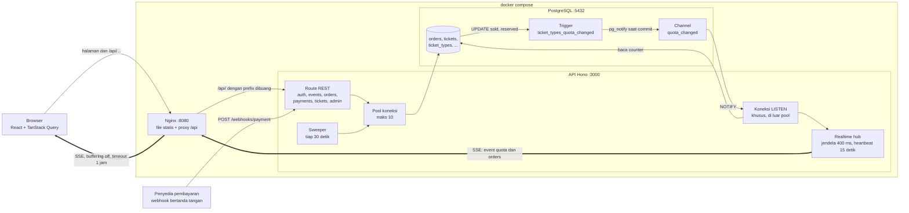

# Arsitektur

## Alur singkat

1. Browser hanya berbicara dengan satu origin. Nginx menyajikan frontend dan meneruskan `/api/` ke API.
2. Semua perubahan kuota terjadi lewat transaksi di Postgres. Trigger memanggil `pg_notify` di transaksi yang sama, dan notifikasi baru terkirim setelah commit.
3. Setiap instance API punya satu koneksi LISTEN khusus. Notifikasi digabung per event dalam jendela 400 ms, counter dibaca lewat koneksi LISTEN itu sendiri (bukan pool, supaya tidak antre di belakang request pesanan), lalu dikirim ke semua stream SSE yang berlangganan event itu.
4. Stream organizer memakai tiket JWT berumur 60 detik di query string. Stream publik hanya mengirim `remaining`.
5. Kalau koneksi LISTEN putus, semua stream ditutup dan browser menyambung ulang. Setelah lebih dari 10 detik putus, browser beralih ke polling tiap 10 detik.
