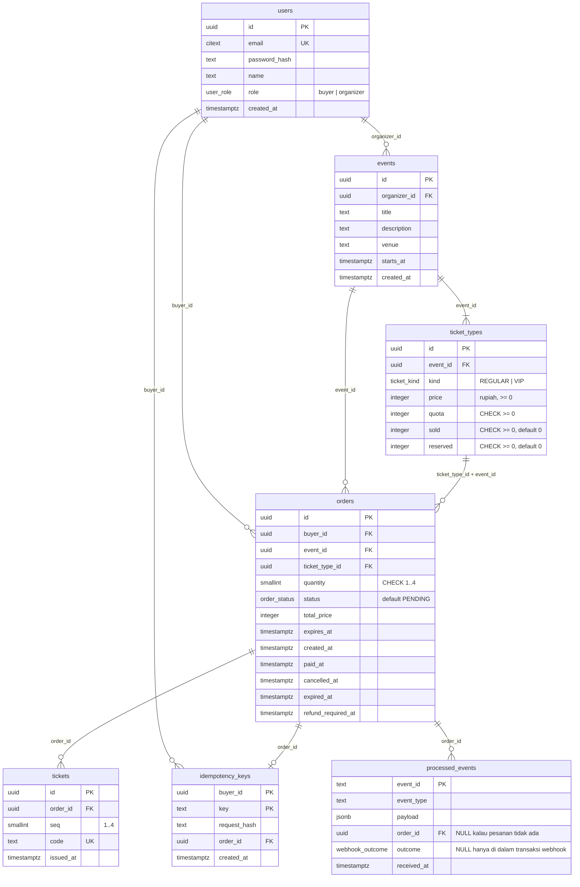

# ERD Quotient

Sumber kebenaran skema adalah folder `api/migrations/` (`0000` sampai `0003`). Diagram ini harus dicocokkan ulang setiap migrasi berubah.

## Enum

| Enum | Nilai | Migrasi |
|---|---|---|
| `user_role` | `buyer`, `organizer` | 0000 |
| `ticket_kind` | `REGULAR`, `VIP` | 0000 |
| `order_status` | `PENDING`, `PAID`, `CANCELLED`, `EXPIRED`, `REFUND_REQUIRED` | 0000 |
| `webhook_outcome` | `PAID`, `ALREADY_PAID`, `REFUND_REQUIRED`, `ALREADY_REFUND_REQUIRED`, `AMOUNT_MISMATCH`, `ORDER_NOT_FOUND`, `PAYMENT_FAILED`, `IGNORED` | 0001 membuat enum dan kolom `outcome`, 0002 menambah `IGNORED` |

## Trigger

| Trigger | Tabel | Fungsi |
|---|---|---|
| `ticket_types_quota_changed`: `AFTER UPDATE OF sold, reserved ... FOR EACH ROW` | `ticket_types` | Memanggil `notify_quota_changed()`, yaitu `pg_notify('quota_changed', event_id)`. Notifikasi terkirim hanya setelah commit, dan notifikasi identik dalam satu transaksi digabung Postgres (migrasi 0003) |

## Constraint yang tidak terlihat di diagram

| Tabel | Constraint | Fungsi |
|---|---|---|
| `ticket_types` | `ticket_types_capacity`: `sold + reserved <= quota` | Pengaman terakhir kuota. Selalu aktif, termasuk saat strategi `naive` |
| `ticket_types` | `UNIQUE (event_id, kind)` | Satu Reguler dan satu VIP per event |
| `ticket_types` | `UNIQUE (id, event_id)` | Target FK komposit dari `orders` |
| `ticket_types` | `price`, `quota`, `sold`, `reserved` `>= 0` | Pengembalian kuota ganda membuat `reserved` negatif dan langsung ditolak |
| `orders` | FK `(ticket_type_id, event_id)` ke `ticket_types (id, event_id)` | Pesanan tidak bisa menunjuk tipe tiket milik event lain |
| `orders` | `quantity BETWEEN 1 AND 4` | Batas per pesanan |
| `orders` | `status <> 'X' OR x_at IS NOT NULL` untuk PAID, CANCELLED, EXPIRED, REFUND_REQUIRED | Status selalu punya jejak waktu |
| `tickets` | `UNIQUE (order_id, seq)`, `seq BETWEEN 1 AND 4` | Satu pesanan tidak bisa menerbitkan tiket dua kali |
| `tickets` | `UNIQUE (code)` | Pengaman tabrakan kode. Keacakan berasal dari generator crypto |

## Index

| Index | Dipakai untuk |
|---|---|
| `orders (buyer_id, event_id) WHERE status IN ('PENDING','PAID')` | Hitung tiket aktif untuk batas 4 per pembeli per event |
| `orders (expires_at) WHERE status = 'PENDING'` | Sweeper kedaluwarsa |
| `orders (buyer_id, created_at DESC)` | Riwayat pesanan pembeli |

## Perpindahan kuota per transisi status

| Transisi | `reserved` | `sold` |
|---|---|---|
| Buat pesanan (PENDING) | +quantity | |
| PENDING ke PAID | -quantity | +quantity |
| PENDING ke CANCELLED atau EXPIRED | -quantity | |
| PENDING lewat `expires_at` (belum disapu) ke REFUND_REQUIRED, karena webhook terlambat | -quantity | |
| EXPIRED atau CANCELLED ke REFUND_REQUIRED | | |

Advisory lock batas 4 tiket tidak ada di skema:
`pg_advisory_xact_lock(hashtextextended(buyer_id::text || ':' || event_id::text, 0))`.
