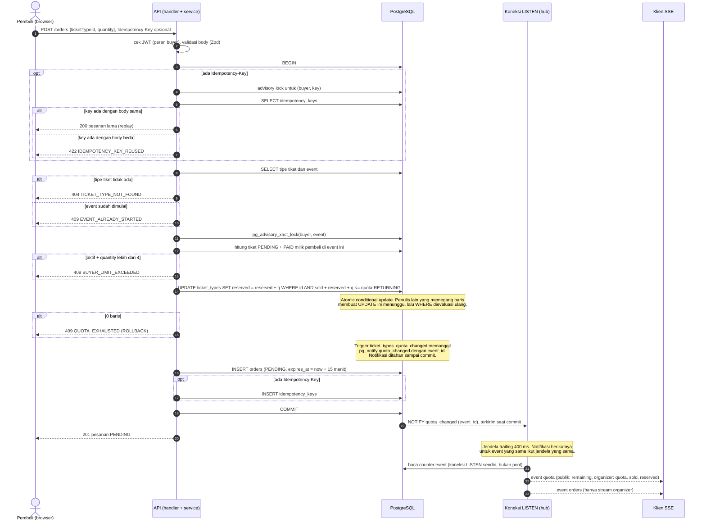

# Alur pembuatan pesanan

`POST /orders` dari request sampai commit dan notifikasi real time. Semua langkah database di antara `BEGIN` dan `COMMIT` adalah satu transaksi (READ COMMITTED).

## Catatan

- Urutan lock: Idempotency-Key, lalu advisory lock pembeli dan event, lalu baris `ticket_types` paling akhir, karena lock barisnya dipegang sampai commit.
- Kalau transaksi dibatalkan di langkah mana pun, tidak ada notifikasi yang terkirim dan Idempotency-Key tidak tersimpan, jadi retry diproses ulang.
- Constraint `ticket_types_capacity` tidak dilewati alur ini karena atomic update sudah menolak lebih dulu. Constraint itu hanya pengaman terakhir.
