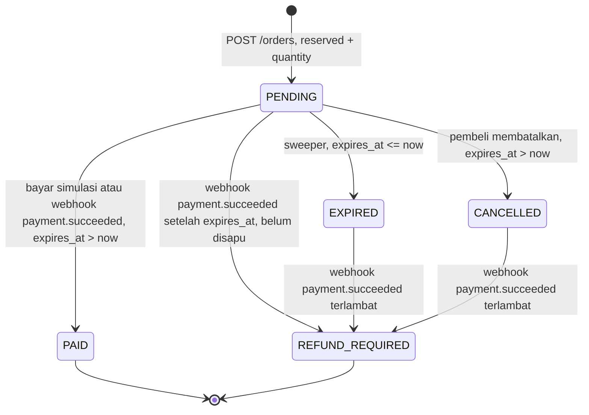

# State machine pesanan

Lima status, dua di antaranya akhir (`PAID` dan `REFUND_REQUIRED`). Setiap transisi adalah satu `UPDATE ... WHERE id = $1 AND status = <asal>` dengan `RETURNING`. Hanya transaksi yang mendapat baris yang menyentuh kuota atau menerbitkan tiket.

## Pemicu dan syarat

| Dari | Ke | Pemicu | Syarat di `WHERE` | Efek ke kuota |
|---|---|---|---|---|
| (baru) | PENDING | `POST /orders` | kuota cukup, batas 4 tiket terjaga | `reserved + quantity` |
| PENDING | PAID | `POST /orders/:id/pay` (hanya mode development) atau webhook `payment.succeeded` dengan `amount` sama | `status = 'PENDING' AND expires_at > now` | `reserved - quantity`, `sold + quantity`, tiket seq 1..quantity terbit |
| PENDING | CANCELLED | `POST /orders/:id/cancel` oleh pemilik | `status = 'PENDING' AND expires_at > now` | `reserved - quantity` |
| PENDING | EXPIRED | sweeper (tiap 30 detik) | `status = 'PENDING' AND expires_at <= now` | `reserved - quantity` |
| PENDING | REFUND_REQUIRED | webhook `payment.succeeded` yang datang setelah `expires_at`, sebelum sweeper jalan | `status = 'PENDING' AND expires_at <= now` | `reserved - quantity` |
| EXPIRED atau CANCELLED | REFUND_REQUIRED | webhook `payment.succeeded` yang datang terlambat | `status IN ('EXPIRED', 'CANCELLED')` | tidak ada, hold sudah dikembalikan |

Batas waktunya saling berlawanan tepat: bayar dan batal memakai `expires_at > now`, sweeper dan jalur webhook terlambat memakai `expires_at <= now`. Untuk satu nilai `now`, sebuah pesanan hanya bisa dibayar atau dibatalkan, atau di-expire, tidak keduanya.

Webhook `payment.failed` tidak mengubah status. Pesanan tetap PENDING dan kedaluwarsa sendiri.
