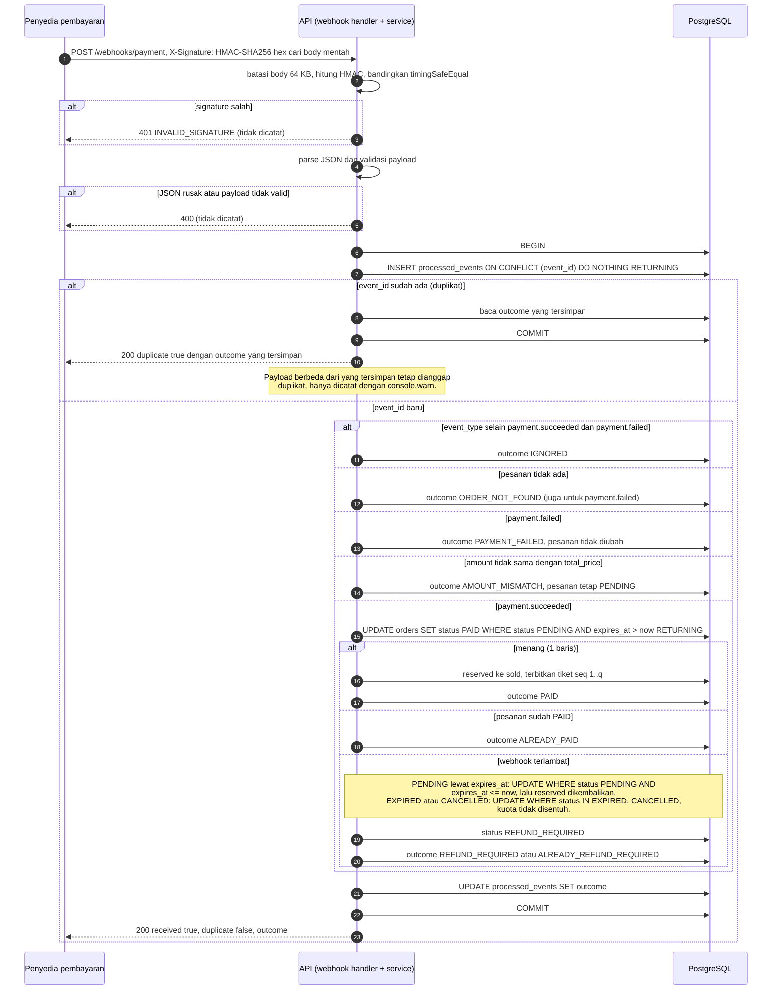

# Alur webhook pembayaran

`POST /webhooks/payment` tanpa JWT. Semua event yang tercatat dibalas 200 supaya penyedia berhenti mengirim ulang.

## Urutan pemeriksaan untuk event baru

Pesanan dicari lebih dulu, jadi `payment.failed` untuk pesanan yang tidak dikenal dicatat `ORDER_NOT_FOUND`, bukan `PAYMENT_FAILED`. Setelah itu `payment.failed`, lalu pencocokan `amount`, baru `payment.succeeded` diproses.

## Kenapa gerbang dedupe paling awal

Dua salinan event yang sama yang datang bersamaan bertemu di primary key `processed_events.event_id`. Salinan kedua menunggu transaksi pertama selesai, lalu `DO NOTHING` membuatnya tidak mengembalikan baris dan ia menjawab sebagai duplikat. Hanya satu salinan yang pernah memproses pesanan.

Kalau transaksi webhook gagal, baris `processed_events` ikut di-rollback, jadi retry dari penyedia diproses ulang.
